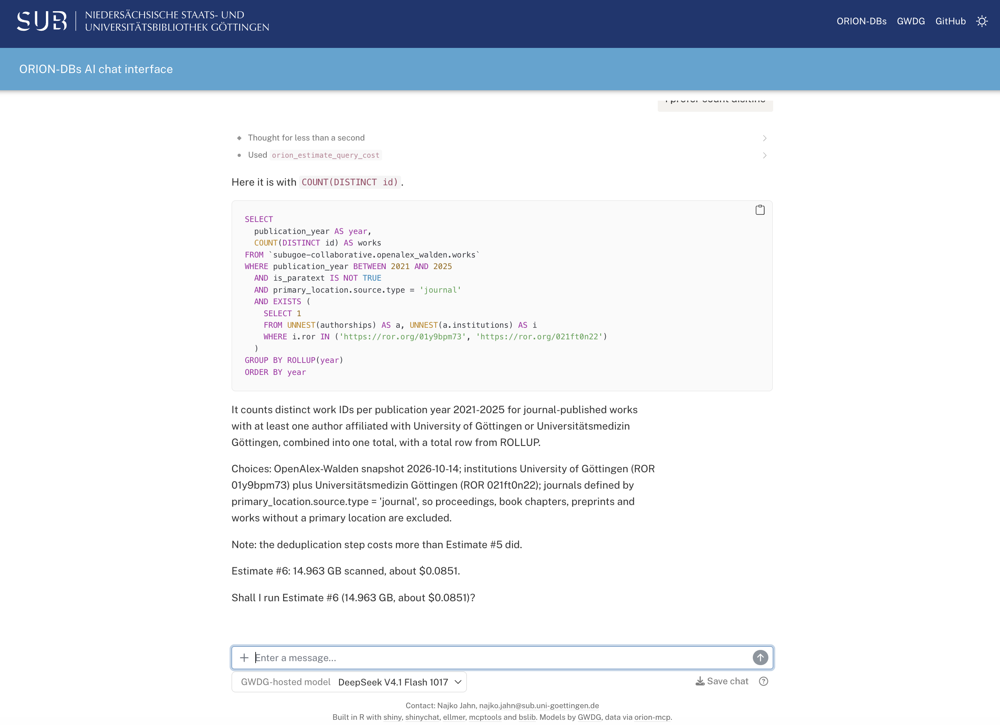

# orion-chat

Shiny app for asking questions about [ORION-DBs](https://orion-dbs.community/) in plain language using [GWDG AI services](https://docs.hpc.gwdg.de/services/ai-services/index.html).

ORION-DBs is a growing collection of open research information on Google BigQuery, including OpenAlex, Crossref and OpenAIRE. The language model writes the SQL queries, which then run on BigQuery.
Safeguards check every query, show its cost in advance, and run nothing above 0.1 GB without approval.

Your prompts, the SQL and the result previews returned by orion-mcp are sent to the GWDG model service; full results and exports stay on your machine. GWDG describes how it handles this data in its [Chat AI data privacy notice](https://docs.hpc.gwdg.de/services/ai-services/chat-ai/data-privacy/index.html).



## Setup

The app needs Docker Desktop, the [orion-mcp](https://github.com/subugoe/orion-mcp) image with Google Cloud credentials (see its README), and a [GWDG API key](https://docs.hpc.gwdg.de/services/ai-services/saia/).

Tested on macOS only. The packages and their minimum versions are listed in `DESCRIPTION`:

```r
install.packages("pak")
pak::local_install_deps()  # run in the orion-chat folder
file.edit("~/.Renviron")
```

Add these lines to `~/.Renviron`, then restart R:

```
GWDG_API_KEY=...
BQ_BILLING_PROJECT=your-google-cloud-project-id
# Optional, the folder for exports; this is the default:
ORION_EXPORT_DIR=~/Downloads/orion-exports
# Optional, queries under this size run without asking (0 turns it off):
ORION_AUTO_RUN_GB=0.1
```

The app starts the orion-mcp container itself. It mounts your Google Cloud credentials from `~/.config/gcloud` (read-only) and the export folder, which it creates if needed. Without `BQ_BILLING_PROJECT` the app still starts, but only schema browsing works. The container uses the table schemas built into the image; `docker pull ghcr.io/subugoe/orion-mcp:latest` updates the image and the schemas.

If `BQ_BILLING_PROJECT` is not set and `~/.config/mcptools/config.json` has an `orion-dbs` entry (the set-up described in earlier versions of this README), the app uses that entry and ignores the other servers in the file.

## Usage

Start Docker Desktop, and run in R:

```r
shiny::runApp()
```

The app is meant to run locally for one person. All browser sessions of the app share one orion-mcp container and its stored results, so it should not be deployed to a shared server in this form.

The model menu below the message box lists the chat models GWDG currently offers. Switching keeps the conversation, so you can ask the same question of another model. The app starts with DeepSeek V4.1 Flash (`deepseek-v4.1-flash-1017`), the fastest GWDG model in tests of the query workflow; `ORION_CHAT_MODEL` in `~/.Renviron` sets another. Not every GWDG model handles tool calls well. Estimating costs is free; running queries is billed to the Google Cloud project. Queries under 0.1 GB, such as looking up an institution's ROR ID, run without asking, so the model can find identifiers in the data instead of guessing them; at the BigQuery on-demand rate they cost less than $0.001 each. Larger queries, exports and new tables always need your approval. A table is written only if the model named it in full (`project.dataset.table`) in the message you approved, and an existing table is replaced only if that message said so.

Each conversation is saved as a Markdown transcript in `transcripts/` inside the export folder, rewritten after each reply. It contains the questions, the SQL, the costs and the result previews. `ORION_SAVE_TRANSCRIPTS=0` in `~/.Renviron` turns this off; Save chat below the message box downloads the current conversation either way.

## Using another model service

By default the app uses GWDG; nothing needs to be set beyond `GWDG_API_KEY`.

For another service with an OpenAI-compatible API, add to `~/.Renviron`:

```
ORION_CHAT_BASE_URL=https://llm.example.org/v1
ORION_CHAT_API_KEY=...
ORION_CHAT_MODEL=model-id
ORION_CHAT_PROVIDER=Example
# Optional: where the name in the top bar and footer links to, and the
# service's data privacy page, linked in the footer
ORION_CHAT_PROVIDER_URL=https://llm.example.org
ORION_CHAT_PRIVACY_URL=https://llm.example.org/privacy
```

For a provider that [ellmer](https://ellmer.tidyverse.org/) supports, name it and the model; the key is read from that provider's usual variable:

```
ORION_CHAT_ELLMER=anthropic
ORION_CHAT_MODEL=claude-sonnet-5-5
ORION_CHAT_PROVIDER=Anthropic
ANTHROPIC_API_KEY=...
```

The model must support tool calling. Only GWDG has been tested.

## Tests

The approval, transcript, provider and start-up functions in `R/` have tests that need no model, Docker or BigQuery:

```r
testthat::test_dir("tests")
```

## AI assistance

Code and documentation were written with the help of [Claude Code](https://claude.com/claude-code) (Anthropic). The app itself does not use Claude.

## License

MIT. The logos in `www/` (SUB Göttingen, University of Göttingen, GWDG) are not covered by the MIT licence. To use the app elsewhere, replace them and change `app_title` and `app_logo` at the top of `app.R`.

## Contact

Najko Jahn <najko.jahn@sub.uni-goettingen.de>
