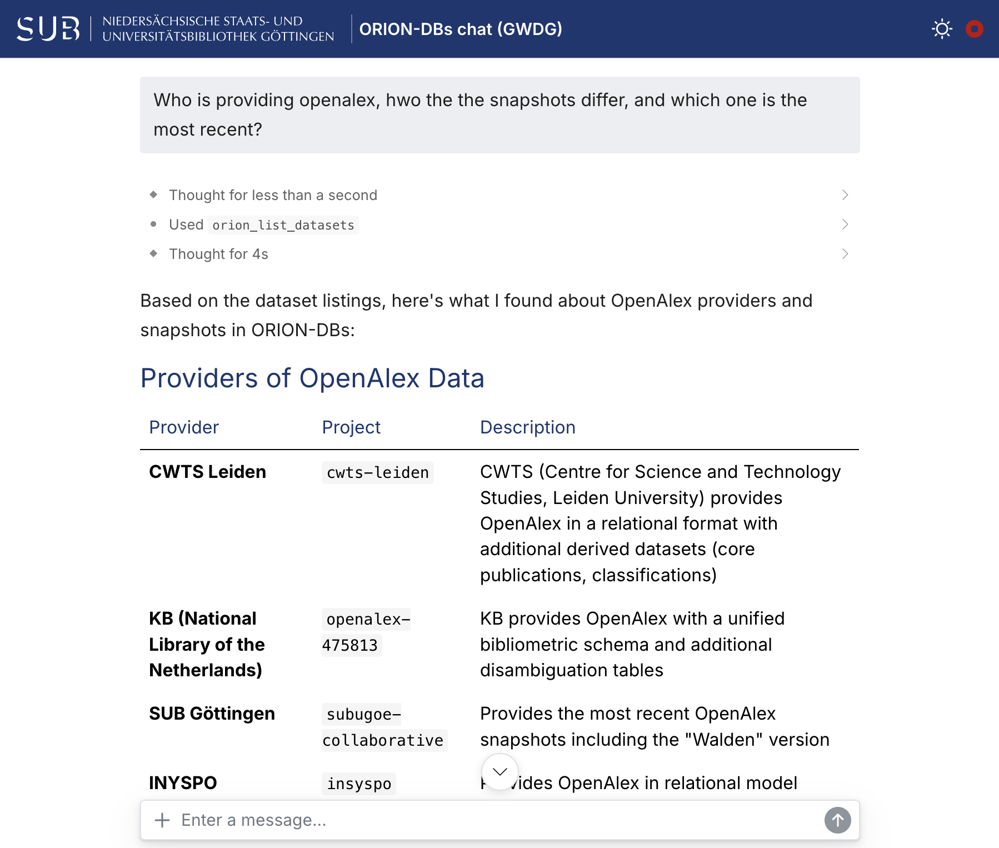

# orion-chat

Shiny app for asking questions about [ORION-DBs](https://orion-dbs.community/) in plain language using [GWDG AI services](https://docs.hpc.gwdg.de/services/ai-services/index.html).

ORION-DBs is a growing collection of open research information on Google BigQuery, including OpenAlex, Crossref and OpenAIRE. The language model writes the SQL queries, which then run on BigQuery.
Safeguards check every query, show its cost in advance, and run nothing without approval.



## Setup

The app needs Docker Desktop, the [orion-mcp](https://github.com/subugoe/orion-mcp) image with Google Cloud credentials (see its README), and a [GWDG API key](https://docs.hpc.gwdg.de/services/ai-services/saia/).

```r
install.packages(c("shiny", "shinychat", "ellmer", "mcptools", "bslib", "sass", "glue", "purrr", "stringr"))
file.edit("~/.Renviron")  # add GWDG_API_KEY=..., then restart R
```

orion-mcp is started via `~/.config/mcptools/config.json`, in the same format as the Claude Desktop config:

```json
{
  "mcpServers": {
    "orion-dbs": {
      "command": "/Users/YOUR_USERNAME/.docker/bin/docker",
      "args": [
        "run", "--rm", "-i",
        "-v", "/Users/YOUR_USERNAME/.config/gcloud:/root/.config/gcloud:ro",
        "-v", "/Users/YOUR_USERNAME/Downloads/orion-exports:/data/exports",
        "-e", "BQ_BILLING_PROJECT=YOUR_PROJECT_ID",
        "ghcr.io/subugoe/orion-mcp:latest"
      ]
    }
  }
}
```

## Usage

Start Docker Desktop, and run in R:

```r
shiny::runApp()
```

The app uses Qwen 3.5 (`qwen3.5-397b-a17b`), which handled the query workflow most reliably of the GWDG models tested; `model` in `app.R` switches to another. Estimating costs is free; running queries is billed to the Google Cloud project.

## AI assistance

Code and documentation were written with the help of [Claude Code](https://claude.com/claude-code) (Anthropic). The app itself does not use Claude.

## License

MIT

## Contact

Najko Jahn <najko.jahn@sub.uni-goettingen.de>
